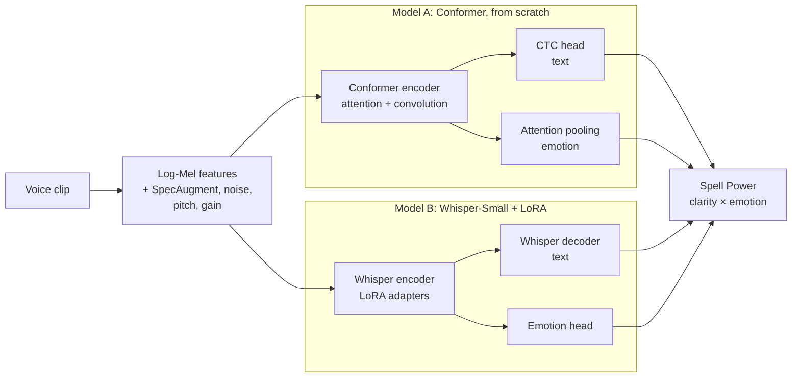
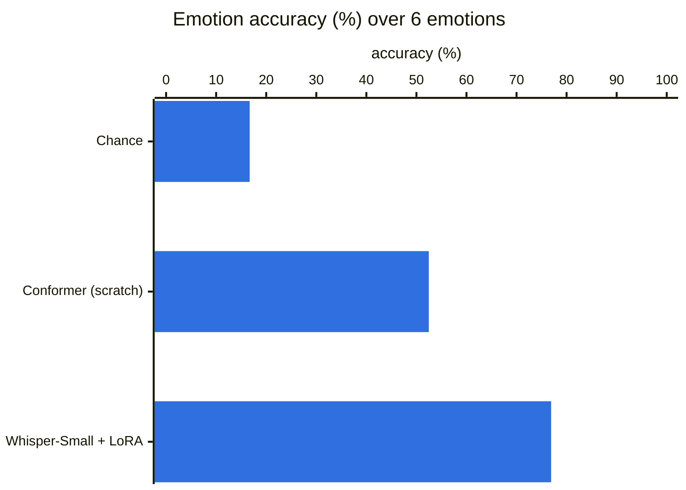
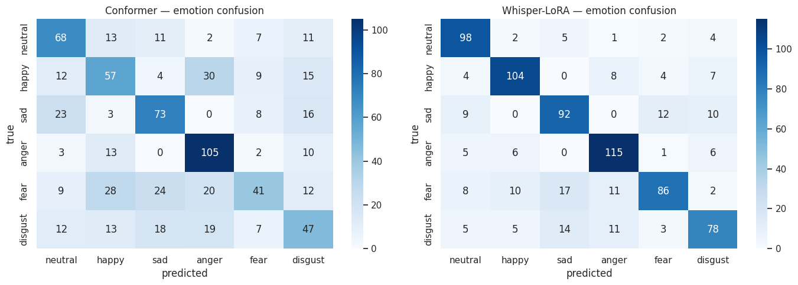
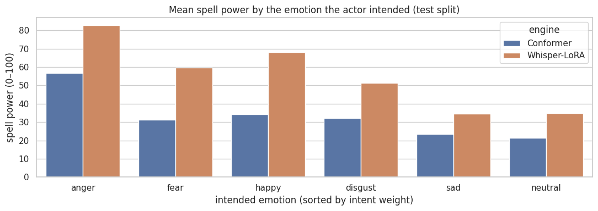

# SpellEngine: Speech + Emotion Recognition for a Voice-Driven Game

**Speak an incantation, and the engine transcribes it and reads the emotion in your voice to decide how powerful the spell is.**

The speech engine behind a spell-casting game. One model does two tasks at once: **ASR** (automatic speech recognition, what was said) and **SER** (speech emotion recognition, how it was said). They combine into a **Spell Power** score. Two approaches are built and compared: a Conformer trained from scratch, and Whisper-Small fine-tuned with LoRA.

## Highlights

- **Multi-task learning:** one shared audio encoder feeds both a transcription head and an emotion head, with loss weights learned automatically (Kendall uncertainty weighting).
- **From scratch vs. fine-tuning:** a 5M-parameter Conformer built from scratch against Whisper-Small adapted with LoRA, which trains only 2.07M of its 244M parameters.
- **Strong results:** 0.15% word error rate and 76.9% emotion accuracy over 6 emotions on CREMA-D.
- **Deployable:** the Conformer is exported to ONNX and runs a 3-second clip in 14.7 ms on CPU (20.5 MB); the LoRA adapters merge into a standalone Whisper model.

**Stack:** Python · PyTorch · torchaudio · Hugging Face Transformers · PEFT (LoRA) · ONNX Runtime · librosa · jiwer

## Architecture



Both tasks are trained together with one combined loss; each task's weight is learned during training rather than hand-tuned.

## Results

On the CREMA-D test split:



| Model | Trainable params | WER ↓ | CER ↓ | Emotion accuracy ↑ | Emotion macro-F1 ↑ |
|---|---|---|---|---|---|
| Conformer (from scratch) | 5.05 M | 7.53% | 2.85% | 52.48% | 0.5138 |
| **Whisper-Small + LoRA** | 2.07 M (of 243.8 M) | **0.15%** | **0.11%** | **76.91%** | **0.7667** |



Neutral, anger and happiness are recognised best; fear and disgust are the hardest and are often confused with sadness.

- **Pretraining wins on accuracy:** Whisper's knowledge of speech gives +24 points of emotion accuracy and a near-perfect transcription.
- **The Conformer wins on cost:** 14.7 ms per clip on CPU with ONNX Runtime (28.0 ms in PyTorch) and 20.5 MB, which is why it's kept as the lightweight option.
- **About the low WER:** CREMA-D has only 12 distinct sentences and, with the default split, the same actors appear in training and test. The WER measures recognition of a small known vocabulary, which matches the game's fixed set of incantations, not open transcription. The notebook supports a stricter speaker-independent split.

<details>
<summary>Per-emotion results</summary>

Per-emotion results for Whisper-Small + LoRA:

| Emotion | Precision | Recall | F1 |
|---|---|---|---|
| Neutral | 0.76 | 0.88 | 0.81 |
| Happy | 0.82 | 0.82 | 0.82 |
| Sad | 0.72 | 0.75 | 0.73 |
| Anger | 0.79 | 0.86 | 0.82 |
| Fear | 0.80 | 0.64 | 0.71 |
| Disgust | 0.73 | 0.67 | 0.70 |

</details>

## Spell Power

```
power   = 100 × intent_weight(emotion) × emotion_confidence × (0.4 + 0.6 × clarity)
clarity = 1 − min(WER, 1)
```

`intent_weight` goes from 1.0 for anger down to 0.4 for neutral. Strong emotion and clear diction cast a stronger spell; a mumbled incantation keeps 40% of its power.



## How it works

1. **Data discovery:** walks the Kaggle input folder for CREMA-D and builds a manifest in
   which every clip serves as both an ASR example and an SER example.
2. **Lazy data pipeline:** one audio file read per item, log-Mel features, SpecAugment, and
   waveform augmentation (noise, gain, pitch) with Audiomentations.
3. **Model A: Conformer from scratch:** feed-forward, multi-head self-attention and
   depthwise-separable convolution blocks, with a CTC head for transcription and an
   attention-pooling head for emotion.
4. **Model B: Whisper-Small + LoRA:** only about 0.7% of the weights are updated. The
   encoder runs once per step and feeds both the decoder (ASR) and the emotion head.
5. **Multi-task loss:** Kendall uncertainty weighting: each task's loss weight is learned
   rather than hand-tuned.
6. **Training loop:** mixed precision (AMP), OneCycleLR, gradient accumulation, and a
   checkpoint manager that resumes interrupted Kaggle sessions.
7. **Evaluation:** WER and CER with `jiwer`, accuracy and macro-F1 for emotions, confusion
   matrices and a side-by-side comparison table.
8. **Export:** the Conformer to ONNX with dynamic axes and a parity check against PyTorch;
   the Whisper LoRA adapters merged into a standalone model.
9. **`cast_spell`:** the game loop in one function: transcribe, read the emotion, score
   clarity against the expected incantation, and return the Spell Power.

## Repository contents

| File | Description |
|---|---|
| `nlp-mini-projet.ipynb` | The full notebook, with training logs, results and figures |
| `figures/` | Figures used in this README, exported from the notebook |
| `requirements.txt` | Python dependencies |

## Dataset

[CREMA-D](https://github.com/CheyneyComputerScience/CREMA-D) (Crowd-Sourced Emotional
Multimodal Actors Dataset): 7,442 audio clips from 91 actors, 6 emotions (neutral, happy,
sad, anger, fear, disgust) and 12 fixed sentences. The dataset is not included in this
repository.

## Run it

The notebook is written for Kaggle:

1. **Settings → Accelerator → GPU T4 x2** (or P100).
2. **Settings → Internet → On**, to install packages and download the Whisper-Small weights.
3. **Add Input** → search for `crema-d` (for example `ejlok1/cremad`).
4. Run all cells. Checkpoints and exports are written under `/kaggle/working/` and training
   resumes from the last checkpoint if a session is interrupted.

## About the project

Mini project for the **Natural Language Processing** module, 2SC IASD, École Supérieure en
Informatique de Sidi Bel Abbès (2025/2026). This notebook is the modeling part of a larger
project in which the engine is served through FastAPI to a Unity 3D game.

## References

- A. Gulati et al., "Conformer: Convolution-augmented Transformer for Speech Recognition",
  *Interspeech*, 2020.
- A. Radford et al., "Robust Speech Recognition via Large-Scale Weak Supervision"
  (Whisper), 2022.
- E. Hu et al., "LoRA: Low-Rank Adaptation of Large Language Models", *ICLR*, 2022.
- A. Kendall, Y. Gal and R. Cipolla, "Multi-Task Learning Using Uncertainty to Weigh Losses
  for Scene Geometry and Semantics", *CVPR*, 2018.
- H. Cao et al., "CREMA-D: Crowd-sourced Emotional Multimodal Actors Dataset", *IEEE
  Transactions on Affective Computing*, 2014.
